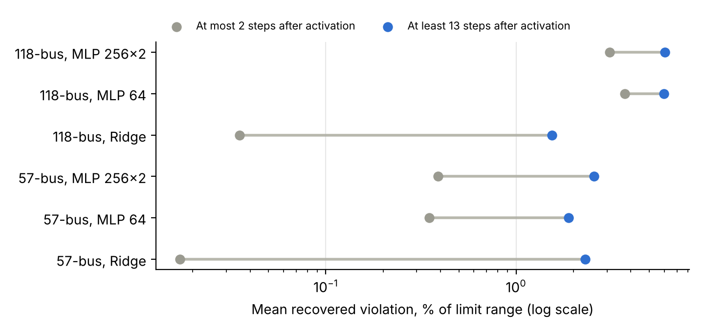

# Active-Constraint Transition Failures in Learned AC-OPF: Experiment and Paper Design

> **Correction, Nov 5, 2026.** The pilot MLPs below were underfit, because early stopping halted them near 57 epochs. With full training on 118 buses, H2 and H1 held, but the ridge inversion behind H3 reversed: ridge had 34.5 MVAr of Q violation against 16.3 to 21.9 for the MLPs. The fallback paper built on H3 is no longer viable. Corrected results are in `results/fully_trained/`. Pilot figures below describe the early-stopped models unless they are corrected elsewhere.

Nov 4, 2026 · @Damilola Agboola

## Bottom line

**Build the paper on one claim: learned surrogates fail to follow a binding transition, so harm grows after a constraint activates and accuracy metrics do not reveal it.** My pilot did not support the simpler claim you might expect, that failures peak at novel active sets, though novelty was low in that sample. Pilot results are exploratory and come from 118- and 57-bus systems with untuned models.

| Decision | Recommendation |
| --- | --- |
| Primary hypothesis | H2: on the active side, violation of a constraint rises with depth, at the same load and the same zero optimal slack |
| Unique contribution | A within-constraint event study that separates setpoint error at the transition from feasibility harm after it |
| Weak claim to avoid | "Novel active sets cause failure." The pilot found no effect on 118 buses, so test it and report it as a secondary result |
| Go/no-go | Replicate H2 on the 300-bus case by Nov 6. If it fails, use the fallback in the schedule |
| Biggest risk | The deadline: [all papers are due 10 November 2026](https://pes-gm.org/2027-san-francisco/2027-call-for-papers/), six days from now, with a five-page limit |

Acceptance cannot be engineered, but three things should help: a controlled finding, a named mechanism, and a direct answer to the zero-slack objection. The call caps conference acceptances at approximately 800 papers, and it publishes no acceptance rate. Any accepted paper must be presented to appear in IEEE Xplore.

## Gap: what prior work leaves unclaimed

No paper I opened measures learned AC-OPF failure as a function of active-set change. The nearest paper states this as a conjecture and leaves it untested, which gives you the opening.

| Work | What it establishes | What it leaves open |
| --- | --- | --- |
| [Li et al., constraint-informed active learning](https://arxiv.org/html/2511.06248v1) (arXiv 2025) | Sampling by predicted active set lowers L1 tail error on 89-, 300- and 1354-bus cases | Conjectures that poor cases map to underrepresented active sets; illustrates it with a contrived two-bus example. No stratified error, no recovered AC feasibility |
| [Dinh et al., proxy reliability analysis](https://par.nsf.gov/servlets/purl/10482464) (ISGT-LA 2023) | Errors concentrate on generators with varying piecewise-linear trajectories and on buses with binding voltage limits | Links error to binding constraints, not to changes in the active set. Uses per-generator complexity, not a per-instance measure |
| [Giraud et al., verification-informed training](https://arxiv.org/pdf/2510.23196.pdf) (arXiv 2025) | Certified worst-case violations on 57–793 buses | Reports violation magnitudes, not where active sets shift. Worst-case bounds do not explain mechanism |
| [OPFData](https://arxiv.org/pdf/2406.07234) (Lovett et al., 2024) | 300k solved instances per grid with N-1 variants | Lists active-set exploration and active-set outputs as future work. Solutions carry no duals, so active sets must be inferred |
| [Baù et al., dataset-quality framework](https://www.emergentmind.com/papers/2508.19083) (arXiv 2025) | Scores datasets on constraint-activation diversity | Assesses the data, not trained-model failures. I read only the abstract page |

**Your defensible niche:** a causal-style measurement of failure at active-set change, on recovered AC power flow, with load level and tightness held constant. Not a new model. Not a new dataset. A diagnostic that turns the Li et al. conjecture into a tested claim.

**Scoop risk:** learned-OPF preprints appear weekly. Rerun the arXiv search on the day you submit.

## Hypotheses and falsification rules

The mechanism to defend is **under-bending**. At a transition, the optimal map bends and a binding quantity stops moving. A smooth surrogate bends less, so its recovered quantity overshoots the limit, and the overshoot grows as the load moves deeper into that regime. This is a proposed explanation, and the signed-overshoot test in H2 is what can falsify it.

| ID | Claim | Test | Supported if | Falsified if | Pilot status |
| --- | --- | --- | --- | --- | --- |
| H1 | Setpoint error rises near a transition | Error against log distance to transition, with episode fixed effects and load | Slope below 0, near/far ratio at least 1.1 | Slope CI includes 0 or is positive on most systems | Supported on 118; 57 too thin to judge |
| **H2 (primary)** | Violation rises with depth into the active region | Same constraint, same path, active side only, load held constant. Add signed overshoot against the pre-transition trend | Slope above 0, CI excludes 0 | Slope CI includes 0 on most systems, or overshoot sign is unrelated to the trend | Supported on 118; same sign on 57, significant in 1 of 3 families |
| H3 | Accuracy does not order harm | Rank correlation of MAE against recovered violation, after tuning | Rank correlation weak, or a lower-violation model with worse MAE | Rank correlation strong and positive on all systems | Observed on both, untuned models |
| H4 | Novel active sets fail more | Hamming novelty regression with load and active-constraint count | Coefficient above 0 after controls | Coefficient CI includes 0 at adequate novelty | Not supported on 118; no novel test instances on 57 |
| H5 | Targeted data reduces harm | Same-budget retraining: reduce the H2 slope more than random additions do | Slope falls more than the random arm, CI excludes 0 | No difference from random | Not tested |

**Decision rule.** H1 to H3 count as confirmed only if they hold in at least two of three surrogate families on at least two of three systems, after Holm adjustment. A system with fewer than 50 clean episodes counts as inconclusive, not as support. I chose these thresholds, so adjust them if you prefer, but do so before the full runs.

**Reporting commitment.** H4 gets reported either way. A clean null on a popular conjecture is a stronger result than a weak positive.

## Formal definitions and metrics

All metrics are computed after AC power flow recovery, so results describe the operating point a grid would see. Each definition below needs only solver primal and dual output.

**Problem and active set.** The load vector x parameterizes the OPF, with optimal solution y\*(x) and inequality constraints h\_i. A constraint is active when its multiplier exceeds a tolerance τ. Sweep τ to show that the results do not hinge on one value.

```latex
\mathcal{A}(\mathbf{x}) = \{\, i : h_i(\mathbf{y}^*(\mathbf{x}),\mathbf{x}) = 0,\ \mu_i^*(\mathbf{x}) > \tau \,\}, \qquad \mathcal{R}_{\mathcal{A}} = \{\, \mathbf{x} : \mathcal{A}(\mathbf{x}) = \mathcal{A} \,\}
```

**Switching set.** Constraints that change status at least once in training, following the [non-trivial constraint idea of Falconer and Mones](https://arxiv.org/pdf/2011.03352v2). Hamming distance and rarity use only this set.

**Recovered violation.** Fix predicted active generation and generator voltages, solve AC power flow, then evaluate every limit. Normalize by limit range. Report non-convergence separately and never drop it silently.

```latex
V(\mathbf{x}) = \max_i \ \frac{\max\{0,\ h_i(\mathrm{PF}(\hat{\mathbf{u}}(\mathbf{x})),\mathbf{x})\}}{r_i}
```

| Symbol | Metric | Definition | What it answers |
| --- | --- | --- | --- |
| N(x) | Active-set novelty | Minimum Hamming distance from A(x) to any training active set | Has the model seen this regime? |
| δ(x) | Transition distance | Load step to the nearest active-set change along a path, in % of total load, refined by bisection | How close is the regime boundary? |
| κ(x) | Kink intensity | Normalized second difference of y\* along a path | How sharply does the optimal map bend here? |
| f\_i | Activation frequency | Share of training instances in which constraint i is active | Is this binding event rare for the model? |
| TFG | Transition failure gap | Excess violation near transitions over far points, matched on load and tightness | Secondary summary near transitions |
| RAG | Rare-activation gap | Violation of rarely active minus commonly active constraints, all at zero optimal slack | Is failure more than the mechanical zero-slack effect? |

```latex
\mathrm{TFG}(\epsilon) = \mathbb{E}\left[ V \mid \delta \le \epsilon \right] - \mathbb{E}_{\text{matched}}\left[ V \mid \delta > \epsilon \right]
```

```latex
\mathrm{RAG} = \mathbb{E}\left[ v_i \mid i \in \mathcal{A}(\mathbf{x}),\ f_i < f_{\text{lo}} \right] - \mathbb{E}\left[ v_i \mid i \in \mathcal{A}(\mathbf{x}),\ f_i > f_{\text{hi}} \right]
```

Exclude constraints the output clamp already enforces, such as non-slack Pg bounds, from RAG and from the depth slope below.

**Depth slope, the primary metric.** D is the number of path steps since constraint i activated, on one clean single-crossing episode e. Every point in this regression has zero optimal slack on the same constraint, so tightness cannot explain the slope. In the pilot, RAG found nothing while this slope did.

```latex
\log_{10} v_{i,e}(t) = \alpha_{i,e} + \beta \log\left(1 + D_{i,e}(t)\right) + \gamma L(t) + \varepsilon_{i,e}(t), \qquad i \in \mathcal{A}(\mathbf{x}(t))
```

## Experiment design

Use PGLearn for instance data and three surrogate families, then run five experiments that each answer one reviewer question. [PGLearn](https://arxiv.org/pdf/2505.22825) already includes AC primal and dual solutions, N-1 variants, and SOC-OPF solutions, so you avoid most data generation.

### Setup

| Item | Choice | Why |
| --- | --- | --- |
| Core systems | 118\_ieee, 300\_ieee, 1354\_pegase | Span of sizes that stays feasible this week |
| Stretch system | 2869\_pegase, audit only | Shows the audit scales without new path solves |
| Instances | PGLearn base split, plus N-1 for one system | Published sampling and an 80/20 split that reviewers can reproduce |
| Surrogates | MLP with MSE; MLP with Lagrangian penalty; heterogeneous GNN | Architecture-agnostic finding; connects to your GNN work |
| Baseline | Ridge regression | Sanity floor for the failure measures |
| Seeds | 5 per model on 118 and 300; 3 on 1354 | Variance estimate for every claim |
| Recovery | Fix Pg and generator V, solve AC power flow | Evaluates the point the grid would see |
| Reference | PGLearn AC solutions; SOC bound for optimality checks | Flags suspect local optima |

### Experiments

| ID | Experiment | Procedure | Reviewer question answered |
| --- | --- | --- | --- |
| E1 | Stratified audit | Split the test set by N(x) = 0, 1, 2–3, 4+. Report error and recovered violation per stratum | Does the average hide a failing subgroup? |
| E2 | Path event study | 50 load paths per system, 81 points each, solved with duals. Refine transitions by bisection. Regress setpoint error on transition distance and active-side violation on depth, with fixed effects per path-constraint episode and load held constant | Does harm track the regime, or just high load? (H1, H2) |
| E3 | Rare-activation gap | Compare violations among constraints at zero optimal slack, binned by f\_i, with bootstrap over constraints | Is this only the mechanical zero-slack effect? |
| E4 | Metric disagreement | Rank all trained models by MAE and by TFG; report rank correlation and tied-MAE pairs | Does this change any decision? |
| E5 | Targeted-data intervention | Same label budget: add K random samples versus K samples deep in active regions and from under-covered active sets. Compare the depth slope and stratified violation on a frozen test set | Is the relationship causal, and is it actionable? |

E2 carries the primary finding, E1 and E3 test the novelty conjecture, E4 shows why the result matters, and E5 is the strongest evidence of mechanism. An optional E6 adds an operator action: use ensemble disagreement to flag instances for solver fallback, and report AUROC with recall at a fixed fallback rate.

### Controls

- **Load and tightness:** both enter every regression as covariates. In E2, path fixed effects remove between-path variation as well.
- **Active-set tolerance:** sweep τ from 1e-5 to 1e-2 and report how many conclusions change.
- **Solver dependence:** re-solve 200 instances with a second solver and report active-set agreement.
- **Local optima:** flag instances with a large gap to the SOC bound. Rerun results with those instances excluded.
- **Non-convergence:** count recovered power flow failures as their own outcome, by stratum.
- **Training coverage:** sweep training size at 1k, 5k and 20k samples. Novelty should fall and the failure gap should persist or shrink predictably.

### Statistics

- Freeze the decision rules in the hypotheses section before running the full experiments, and commit them to Git with a timestamp.
- Cluster standard errors by path in E2 and by constraint in E3. Seeds are not independent samples of the grid.
- Report effect sizes with 95% bootstrap intervals, plus Holm-adjusted p-values across the three primary tests.
- Keep the 1354-bus test set untouched until the method is frozen on 118 and 300.

## Pilot evidence

The pilot changed the thesis: harm grew after activation, not at it, and the simple novelty claim found no support. Treat these as exploratory results that justify the design. They are not publishable numbers, because the models are untuned and the systems are small.

**Setup.** PGLib 118- and 57-bus cases, global load U(0.85, 1.15) times local U(0.9, 1.1), 20 straight-line load paths of 41 points. Seven scikit-learn models: ridge, three seeds of MLP (64), three seeds of MLP (256, 256). 118-bus used 1,800 training and 600 test instances; all 3,220 solves converged. 57-bus used 800 training and 348 test instances; 594 of its 2,320 solves did not converge and were dropped.



*Pilot run, PYPOWER AC-OPF and power flow recovery. 118-bus: 213 episodes. 57-bus: 13 episodes. Family means across seeds where applicable.*

In a fixed-effects test on the same constraint and path, with load held constant, the depth slope was significant in all three families on 118 buses (p below 1e-7). On 57 buses, it was positive in all three but significant only for ridge (p = 0.023), with MLP 256x2 at p = 0.050 and MLP 64 at p = 0.67. Near and deep values on this chart are raw means, so ratios with very small denominators overstate the effect.

| Claim tested | 118-bus result | 57-bus result | Reading |
| --- | --- | --- | --- |
| Vg error near a Qmax transition versus far | 1.26 to 1.68 times higher; p below 1e-8; 136 episodes | Same sign; p = 0.03, 0.63, 0.81; 4 episodes | Real on 118, not testable on 57 |
| Pg error against kink intensity | +7.7% per SD, p below 1e-10 | Not available | Small effect |
| Peak-violation metric against kink intensity | Not significant, p = 0.10, negative | Not available | Violation does not peak at the kink |
| Ridge versus best MLP, Vg MAE (pu) | 0.00209 versus 0.00116 | 0.00121 versus 0.00108 | Ridge is less accurate |
| Ridge versus MLP range, total Q violation (MVAr) | 34.5 versus 88.8 to 124.3 | 1.25 versus 3.30 to 5.40 | Ridge violates less |
| Novel active sets | 10% of test; Hamming p = 0.71 for violation, 0.31 for Pg error | 0% novel | No support; low novelty and power |
| Rarely versus commonly active, zero slack | Gap -0.010, 95% CI -0.050 to 0.026; 7 rare constraints | Not available | No support |
| Differential Vg error explains Q violation | R² = 0.014 | R² below 0.001 | Rejected as an explanation |

### What this changes in the design

- **Voltage and reactive limits dominate.** Of 118-bus switching constraints not enforced by the output clamp, 25 of 32 are Qmax or Qmin. Thermal limits account for only 5. The paper should centre on Vg and Q, which many Pg-focused evaluations under-report.
- **Report physical units.** Max range-normalized Q violation reached 130–190% of a limit range for the MLPs, largely because Q ranges span 10 to 2,000 MVAr. Use MVAr and MVA alongside normalized values.
- **Separate a floor from the regime effect.** MLPs had violation near activation about 100 times that of ridge on 118 buses, so most of their harm is not regime-driven. The paper must report what share the regime effect explains.
- **The ridge result needs care.** I did not find its cause, and a differential-voltage explanation failed. Tune the MLPs before you claim an inversion, because a tuned network may remove it.
- **Plan for solver limits.** PYPOWER converged on 3 of 6 random 300-bus instances at 2 to 8 seconds each. Use Ipopt for path solves.

**Disclosures for your own records.** The 57-bus split changed from 1,100 to 800 training instances after the first run left only 48 test instances. Under the first split, the Vg error slope had mixed signs, which is further reason to treat 57-bus H1 as unresolved. The depth test and its episode definition came from looking at the 118-bus data, so that system cannot confirm them. Only new systems can.

## Five-page paper structure

The paper carries three figures and two tables, because five pages leave no room for a sixth exhibit. Related work is merged into the introduction so the page budget goes to results. Page shares below are my planning estimates.

| Section | Pages | Content | Exhibit |
| --- | --- | --- | --- |
| Abstract | 0.15 | Context, problem, limitation, novelty, quantitative result | |
| I. Introduction and related work | 0.75 | Average metrics hide regime failure; three-branch critical review; contributions as a numbered list | Table I: gap against nearest work |
| II. Problem and failure model | 0.6 | AC-OPF as a parametric program; active sets and critical regions; why the optimal map bends; hypotheses | |
| III. Evaluation methodology | 0.9 | Metrics N, δ, κ, TFG, RAG; recovery; matching and fixed effects | Fig. 1: one path showing active-set change, kink and violation on a shared axis |
| IV. Experimental setup | 0.35 | Systems, PGLearn sampling, models, solvers, reproducibility | |
| V. Results | 1.5 | E2 event study first; then E4 metric disagreement, E1 and E3 tests of the novelty conjecture, and E5 intervention | Fig. 2: event-study curves. Fig. 3: violation near versus deep, by family and system. Table II: audit by system and model |
| VI. Discussion and limits | 0.35 | Operator action; what the result does not show; threats to validity | |
| VII. Conclusion and references | 0.4 | Three-sentence close; 15–20 focused references | |

### Title and contributions

Keep your title if H2 replicates. Read "transition failures" as failure to follow a transition, and do not imply that harm peaks at the transition point.

1. A per-instance, solver-derived diagnostic for regime failure of learned AC-OPF: novelty, transition distance and kink intensity.
2. A controlled within-constraint measurement of harm after activation on recovered AC power flow, separated from load and zero-slack effects.
3. Evidence on whether nominal metrics rank models differently from transition-aware metrics.
4. A test of the active-set coverage conjecture, by novelty regression and by same-budget intervention.

### Abstract skeleton

Bracketed values are unmeasured. Fill them from experiments only, and cut any sentence the results do not support.

> Learned AC optimal power flow surrogates report small average prediction errors, which supports their proposed use in fast dispatch. These averages do not indicate where failures concentrate in the load space, and a surrogate that smooths the change in binding constraints may overshoot limits that the optimal solution holds exactly. Existing evaluations report aggregate error or worst-case violation bounds, and active-set explanations of poor performance remain conjectural. We define solver-derived measures of active-set novelty, transition distance and depth, and measure recovered AC power flow violations within each constraint episode with load level held constant and optimal slack at zero. Across \[N\] systems and \[M\] surrogate families, recovered violation rises by \[x\] from activation to depth \[d\] while setpoint error peaks within \[e\] of the transition, and accuracy rankings correlate with violation rankings at only \[r\].

### Venue fit

The [2027 call](https://pes-gm.org/2027-san-francisco/2027-call-for-papers/) lists "AI-Human Coordination, Data Fusion and Automation" under its Situational Awareness super session, and the fallback flag in E6 connects to that. Otherwise this sits as an analytic-methods paper. Select the topic and committee on the submission site when you see its actual list.

## Anticipated reviewer objections

The zero-slack objection is the most dangerous, so build the paper around answering it. Each defense below names the exhibit that carries it, so no answer rests on argument alone.

| Likely objection | Why it has force | Defense | Evidence |
| --- | --- | --- | --- |
| "Binding constraints have zero slack, so any error violates them. This is trivial." | True for any approximation | Compare each constraint with itself on the active side, where optimal slack is zero at every point. Tightness is equal by construction | E2, depth slope |
| "You are just measuring high load." | Load drives both active-set change and error | Path fixed effects and load covariates; report the load coefficient beside the transition coefficient | E2 |
| "Active-set labels depend on the solver and tolerance." | Interior-point multipliers are never exactly zero | Sweep τ over three decades; second-solver agreement on 200 instances | Controls table |
| "AC-OPF is non-convex, so jumps could be local optima." | True; a solver can change basin along a path | Flag large SOC gaps and rerun with exclusions | Controls |
| "Your models are weak. A better model would fix this." | Pilot-scale MLPs are easy to dismiss | Three families, including GNN and Lagrangian, tuned against validation violation; report whether the slope and any ridge inversion persist with training size | E1, training sweep |
| "Power flow recovery is one choice among many." | Fixing Pg and V moves violations onto Q and flows | State this openly; add a projection or solver warm-start check on one system if time allows | Discussion |
| "Hard-constrained methods make this moot." | Some methods guarantee feasibility | They move the failure to optimality or solve time. Report that as the open extension and do not claim coverage of them | Discussion |
| "Load sampling is unrealistic." | Synthetic perturbations differ from operations | Use published PGLearn sampling, and name real time-series validation as future work | Setup |
| "This is correlation, not cause." | Observational designs have limits | The same-budget intervention manipulates coverage directly | E5 |
| "Nothing here helps an operator." | PES readers value use | Stratum-based acceptance rule, or E6 fallback flag at a fixed fallback rate | E4, E6 |
| "N-1 is absent or limited." | Operations are security-constrained | Run the audit on one N-1 system and state the limit | E1 |

### What the paper must not claim

- Do not call transitions the sole cause of failure. Pilot MLPs had a large violation floor unrelated to regime, so report the share the regime effect explains.
- Do not claim proof of a discontinuity. In a smooth region of the program, the primal map is continuous with kinks, so kink language is the safe default.
- Do not generalize beyond the systems, sampling and recovery rule tested.
- Do not write "first" without a dated search behind it. "To our knowledge" still needs that search.

## Six-day schedule and cut lines

The work fits only if the 300-bus replication happens first and everything optional stays optional. Dates assume you start today, and the plan leaves Nov 10 as buffer. Confirm the deadline's time zone on the submission site.

1. **Nov 4–5: replication.** Commit the decision rules. Generate 300-bus paths with Ipopt. Run the frozen pilot scripts unchanged with tuned MLPs.
2. **Nov 6: go/no-go.** Evaluate H1, H2 and H3 on 300 buses. Choose the main paper or the fallback.
3. **Nov 6–7: models.** Train the Lagrangian MLP and GNN on PGLearn, with seeds. Run E1 audit and E3 on 118 and 300.
4. **Nov 7–8: remaining results.** Run the signed-overshoot test, E4, and E5 if time allows. Open 1354\_pegase for the E1 audit only.
5. **Nov 8–9: writing.** Draft all sections and produce the three figures. Replace every bracket in the abstract with a measured value.
6. **Nov 9: checks.** Have a coauthor attack the zero-slack defense. Rerun the arXiv search, and check PES template, page and any review-anonymity rules.
7. **Nov 10: submit early.** Keep the morning as buffer.

### Cut order if time runs short

| Cut | Consequence | Keep at all costs |
| --- | --- | --- |
| E6 fallback flag | Lose the operator hook; the discussion can propose it instead | H2 event study |
| 2869 audit, then 1354 audit | Fewer large-system claims | 118 and 300 replication |
| N-1 audit | State as a limitation | Recovered AC power flow metrics |
| E5 intervention | Lose causal support; call the result associational | Tuned models |
| GNN | Two families remain; change the decision rule first | At least two families |

### Fallback if H2 fails on 300 buses

Submit "Beyond Nominal Accuracy" as a metric-disagreement study instead, built on H3 and the H4 test of the active-set conjecture. Change the subtitle so it no longer promises transition failures. If tuning also removes H3, do not force a GM submission. Take the pipeline to a later venue with a longer timeline.

## Sources and items to verify

**Pages opened:** [2027 PES GM call for papers](https://pes-gm.org/2027-san-francisco/2027-call-for-papers/) · [PGLearn](https://arxiv.org/pdf/2505.22825) · [OPFData](https://arxiv.org/pdf/2406.07234) · [Li et al.](https://arxiv.org/html/2511.06248v1) · [Dinh et al.](https://par.nsf.gov/servlets/purl/10482464) · [Giraud et al.](https://arxiv.org/pdf/2510.23196.pdf) · [Baù et al., abstract page](https://www.emergentmind.com/papers/2508.19083)

**Seen only as search excerpts; read before citing:** [Falconer and Mones](https://arxiv.org/pdf/2011.03352v2) · [PF-in-the-loop correction under distribution shift, Oct 2026](https://arxiv.org/html/2610.36236), which I could not open and which is recent enough to check closely · [Deka and Misra](https://arxiv.org/pdf/1902.05607)

**Verify yourself:**

- [ ] PES Authors Kit: template, whether references count toward five pages, and any anonymity rule. The call did not state these
- [ ] Prior-publication policy, if you plan an arXiv posting
- [ ] A dated search of IEEE Xplore, which I did not search, before any "first" claim
- [ ] Citation details for every reference; the table above comes from AI-assisted page summaries, so check it against the papers
- [ ] Co-author and advisor agreement on the hypothesis change
